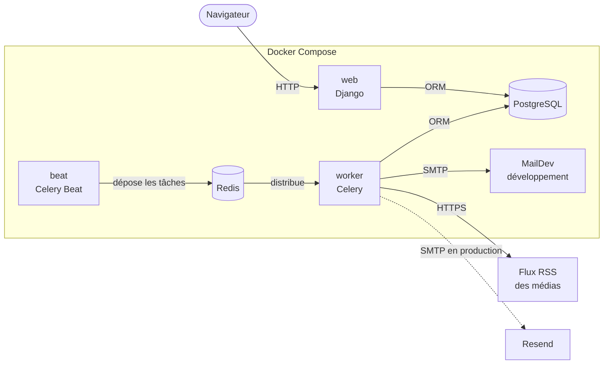
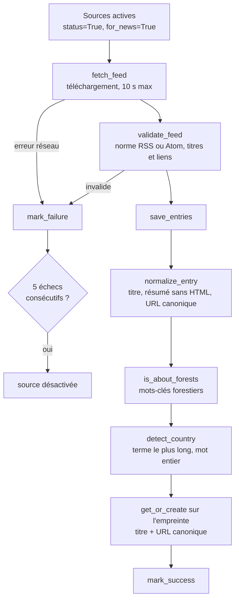

# Architecture

InForêt est un monolithe Django : le serveur produit les pages HTML, et du
JavaScript ciblé n'intervient que là où il est indispensable. Les traitements
longs — collecte des flux, envoi du mail hebdomadaire — tournent en tâche de
fond, en dehors des requêtes web.

## État des fonctionnalités

| Fonctionnalité | Application | État |
|---|---|---|
| Comptes, connexion, préférences | `accounts` | Fait |
| Export et suppression des données | `accounts` | Fait |
| Flux d'actualités, pays suivi en tête | `news` | Fait |
| Favoris et historique | `news` | Fait |
| Collecte et normalisation des flux RSS | `news` | Fait |
| Mail hebdomadaire et désinscription | `accounts` | Fait |
| Supervision des sources | `core` | Fait (administration Django) |
| Flux de connaissances | `discovery` | Modèle en place, vues sur données d'exemple |
| Carte des forêts | `maps` | Sélecteur de couches, sans données |

## Vue d'ensemble

`web`, `worker` et `beat` partagent la même image et le même code : seule la
commande de démarrage diffère. Ils se joignent par le nom de service (`db`,
`redis`, `maildev`) sur le réseau interne de Docker.

## Les applications

| Application | Rôle | Fichiers clés |
|---|---|---|
| `core` | Référentiels partagés : pays et sources de flux | `models.py`, `admin.py`, `feeds.py`, commandes `seed_*` |
| `accounts` | Utilisateur, authentification, droits RGPD, mail hebdomadaire | `models.py`, `views.py`, `newsletter.py`, `tasks.py` |
| `news` | Actualités, favoris, historique, pipeline de collecte | `services.py`, `views.py`, `tasks.py`, commande `fetch_feeds` |
| `discovery` | Contenus de découverte en trois catégories | `models.py`, `views.py` |
| `maps` | Carte des forêts | `views.py` |
| `config` | Réglages, URL racines, application Celery | `settings.py`, `celery.py` |

`core` existe parce que deux applications ont besoin des pays : `accounts`
pour le pays suivi par un utilisateur, `news` pour le pays dont parle un
article. Placée dans l'une des deux, la table rendrait l'autre dépendante sans
raison.

## Collecte des actualités

Déclenchée par `beat` à 6 h, 12 h et 18 h (heure de Paris), ou à la main par
`python manage.py fetch_feeds`. Le code est dans `apps/news/services.py`, une
fonction par étape :

Les étapes avant `save_entries` ne touchent pas la base : elles se testent
sans réseau ni données.

Un article est identifié par une **empreinte** SHA-1 du titre normalisé et de
l'URL canonique, et non par son URL brute : une même page circule avec des
paramètres de suivi (`utm_source`, `fbclid`…) ou une barre oblique finale qui
changent l'URL sans changer l'article. L'unicité est garantie par une
contrainte en base, pas seulement par le code.

## Mail hebdomadaire

Déclenché par `beat` le lundi à 8 h, ou par `python manage.py send_weekly`.
Le code est dans `apps/accounts/newsletter.py`.

1. Sélection des abonnés : inscrits au mail, compte actif, non servis depuis
   six jours, du moins récemment servi au plus récent, cent au plus par lot.
2. Pour chacun, cinq articles publiés dans les sept derniers jours : son pays
   d'abord, le monde en complément.
3. Un abonné sans article ne reçoit rien.
4. Le message part en deux versions, texte et HTML, avec les en-têtes
   `List-Unsubscribe` et `List-Unsubscribe-Post`.
5. La date d'envoi est enregistrée après chaque message : si le lot
   s'interrompt, personne n'est servi deux fois.

## Lecture d'un article

Le contenu des articles reste chez l'éditeur. Le lien « Lire l'article »
passe par `/news/<id>/read/`, qui compte la consultation, met à jour
l'historique de l'utilisateur connecté et la note de l'article, puis redirige
vers le site d'origine.

## Modèle de données

| Table | Contenu | Contraintes notables |
|---|---|---|
| `core_country` | Pays ISO 3166-1, termes de reconnaissance | `iso_code` unique |
| `core_source` | Flux RSS et leur état de santé | `feed_url` unique |
| `accounts_user` | Comptes, pays suivi, inscription au mail | `email` unique, `newsletter_token` unique |
| `news_news` | Actualités normalisées | `hash` unique, index sur `(country, -published_at)` |
| `news_usernewsfavorite` | Favoris | clé primaire composée `(user, news)` |
| `news_usernewshistory` | Historique de lecture | clé primaire composée `(user, news)` |
| `discovery_discovery` | Contenus de découverte | — |

Les clés primaires sont des UUID. Les deux tables de liaison utilisent une clé
primaire composée, que Django 5.2 gère nativement : un favori en double est
impossible au niveau de la base. Contrepartie, ces tables ne peuvent pas être
enregistrées dans l'administration Django.

La suppression d'un compte efface en cascade ses favoris et son historique.
La suppression d'un pays du référentiel met à `NULL` le pays des comptes et
des articles, sans les supprimer.